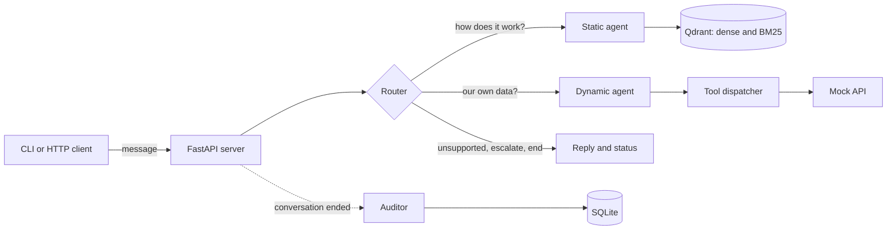

# Support Agent Sandbox

A customer support agent for an HR and payments product. Ask it how something works and it answers from the help
articles and tells you which sections it used. Ask it about the account ("which bills are overdue?") and it calls a
read-only API, and you can see every call it made. Conversations are kept separate, it asks when something is unclear,
and it says so when it can't help.

It comes with a chat CLI, an HTTP API, a Docker setup, a test set with the traces of every run, and a latency test.

## Run it

You need Docker with Compose, [`uv`](https://docs.astral.sh/uv/) (Python 3.12) for the CLI, tests and evals, and an
OpenAI API key.

```bash
cp .env.example .env              # put your key in OPENAI_API_KEY
docker compose up --build         # the server, on http://localhost:9090
curl localhost:9090/health        # {"status":"ok"} when it is ready (about 10 seconds after the image is built)
uv sync
uv run python main.py             # chat
```

If the Docker build is slow, it is almost certainly PyPI. Build against a mirror that is fully synced with it:

```bash
PYPI_MIRROR=https://pypi.tuna.tsinghua.edu.cn/simple docker compose up --build
```

`uv.lock` pins every package by hash, so the same files get installed from any mirror. Two mirrors we tried didn't work:
one was missing a recently released package, and one rate-limited the parallel downloads.

To run without Docker, leave `QDRANT_URL` empty. The server then uses an in-memory Qdrant and re-embeds the guide on each
start, which costs a fraction of a cent:

```bash
uv run uvicorn app.http.server:app --port 9090
```

Tests: `uv run pytest` runs 54 unit tests. They use fake models, so they make no API calls and cost nothing.

## Talk to the server directly

This is the same API the CLI uses, so you can test the agent from any HTTP client. A conversation has three steps:
create it, send messages, delete it. The server keeps the history, so each request only carries the new message.

```bash
# 1. start a conversation
curl -s -X POST localhost:9090/conversations
# {"conversation_id":"6d0f0c7e-..."}

# 2. send a message (repeat for follow-ups, always with the same id)
curl -s -X POST localhost:9090/conversations/6d0f0c7e-.../messages \
  -H 'content-type: application/json' \
  -d '{"message": "Is Marisol Okonjo'"'"'s onboarding finished, or is something outstanding?"}'

# 3. when you are done
curl -s -X DELETE localhost:9090/conversations/6d0f0c7e-...
```

A real response to that question (the reply is shortened):

```json
{
  "reply": "Marisol Okonjo's onboarding is not finished yet.\n\n- Onboarding steps: 5 total, 4 completed. 1 step remains: I-9 Section 2.\n- I-9 Section 2 status: PENDING, blocked on EMP...",
  "status": "active",
  "route": "dynamic",
  "queries": [
    {"agent": "dynamic", "query": "Is Marisol Okonjo's onboarding finished, or is something outstanding?"}
  ],
  "sources": [
    "GET /employer/current/employees",
    "GET /employer/current/employee/emp-03100"
  ],
  "tool_calls": [
    {"tool": "list_employees", "arguments": {"name": "Marisol Okonjo"}, "endpoint": "GET /employer/current/employees", "ok": true},
    {"tool": "get_employee", "arguments": {"employee_id": "emp-03100"}, "endpoint": "GET /employer/current/employee/emp-03100", "ok": true}
  ],
  "timings_ms": {"router": 1435, "agents": 6284, "total": 7719}
}
```

A docs question looks the same with `"route": "static"`, the help sections it used under `sources` (for example
`"Part 2 — Niural Pay > How to add a vendor"`) and an empty `tool_calls`. A request the system can't handle comes back
with `"route": "unsupported"`, an offer to escalate or end, and `"status": "active"`.

The fields in a response:

| Field | What it is |
|---|---|
| `reply` | The answer to show the customer. If it is based on something, a `Sources:` list is added at the end of the text. |
| `status` | `active` means keep going. `ended` or `escalated` means the conversation was closed and the id no longer works. |
| `route` | Where the message went: `static` (help articles), `dynamic` (account data), `static+dynamic`, `unsupported`, `escalate`, `end`, or `error` (something failed and the reply is an apology). |
| `queries` | The question as the router rewrote it for each agent. "Sorry, I meant contractors" shows up here as "How many contractors do we have?". |
| `sources` | The help-article sections or API calls the answer is based on. Empty when nothing supports it. |
| `tool_calls` | Every tool call the agent made: the tool, its arguments, the API call it turned into, and whether it worked. `endpoint` is `null` if the call was rejected before reaching the API. |
| `timings_ms` | Where the time went: the router, the agents, and the whole turn. |

A script that runs a short conversation and prints what the agent did (run it with `uv run python`, which has `httpx`):

```python
import httpx

questions = [
    "How do I add a vendor?",
    "and for a bill instead?",
    "Which bills are overdue right now?",
]

with httpx.Client(base_url="http://localhost:9090", timeout=120) as client:
    convo = client.post("/conversations").json()["conversation_id"]
    for question in questions:
        r = client.post(f"/conversations/{convo}/messages", json={"message": question}).json()
        print(f"> {question}\n{r['reply']}\n")
        print(f"route: {r['route']}   time: {r['timings_ms']['total'] / 1000:.1f}s")
        for call in r["tool_calls"]:
            print(f"tool call: {call['tool']} {call['arguments']} -> {call['endpoint']} {'ok' if call['ok'] else 'FAILED'}")
        print()
    client.delete(f"/conversations/{convo}")
```

All the endpoints:

| Method and path | What it does |
|---|---|
| `GET /health` | `200` once Qdrant is up and the guide is loaded, otherwise `503`. |
| `POST /conversations` | Starts a conversation and returns its id. |
| `POST /conversations/{id}/messages` | Body `{"message": "..."}`. Returns the response described above. |
| `DELETE /conversations/{id}` | Ends the conversation. Always `204`, even if it already ended. This is also what triggers the audit. |
| `GET /audits` | The auditor's verdicts on finished conversations, newest first. `?review=pending` for the ones nobody has looked at. |
| `GET /audits/{id}` | One audit with the whole conversation. |
| `POST /audits/{id}/review` | Body `{"decision": "approved" or "rejected", "note": "..."}`. |

Things worth knowing when you test it:

- A request takes between 1 and 10 seconds, depending on what is asked (see the latency table below), so use a timeout of a
  minute or more.
- Conversations are independent. Run as many as you like in parallel. We tested 8 at once with no errors.
- `404` means the conversation doesn't exist or has already ended or escalated. `422` means an empty message.
- If the model fails after its retries, you still get a `200` with `route: "error"` and an apology, and the conversation
  stays open so you can try again.
- When the agent escalates or ends a conversation it returns `status: "escalated"` or `"ended"` and closes it. Start a
  new one to keep going.
- Interactive docs are at `/docs`.

## Chat in the terminal

```bash
uv run python main.py                          # chat
uv run python main.py chat --log session.jsonl # also save every turn to a file
uv run python main.py audit                    # review the auditor's verdicts
uv run python main.py --url http://host:9090   # a server somewhere else
```

After every answer the CLI shows what the agent did, so you can see your question, the route and each tool call (the
reply is shortened here):

```
you> Why hasn't Halberd Components been paid yet?
  route: dynamic
  tool call 1: list_vendor_invoices({"vendor_name": "Halberd Components"})
      -> GET /vendor-invoices  [ok]
  tool call 2: get_vendor_invoice({"invoice_id": "vinv-2041"})
      -> GET /vendor-invoices/vinv-2041  [ok]
  time: 8.7s (router 1.3s, agents 7.4s)
agent> Halberd Components has one outstanding bill, INV-2041, waiting on approval from Beatrix Nolan ...

Sources:
- GET /vendor-invoices
- GET /vendor-invoices/vinv-2041
```

`/new` starts a fresh conversation and `/quit` leaves (which ends the conversation). In `audit` mode you can `list` the
pending audits, `show <id>` for the transcript, tool calls and verdict, and `approve <id>` or `reject <id>` with an
optional note.

## How it works



Every message goes to the **router** first. It reads the message and the conversation so far and picks one of four
things to do:

| Action | What happens |
|---|---|
| `answer` | Send one or two queries to the agents. The router rewrites each query so it makes sense on its own. A message that mixes a how-to and a data question goes to both agents and the answers are joined. |
| `unsupported` | The request is outside what the system does (the wallet, time off, refunds, changing data). The reply says so and offers to escalate or end. The conversation stays open for the answer. |
| `escalate` | The customer asks for a person, or accepts the offer. The conversation is closed with status `escalated`. |
| `end` | The customer says thanks or that they're done. Closed with status `ended`. |

### The static agent

It answers "how does the product work" questions from the help articles.

When the server starts, it reads `docs/PRODUCT_GUIDE.md`, splits it into chunks of about 300 tokens (with
[Chonkie](https://github.com/chonkie-inc/chonkie)) and labels each chunk with its heading path, for example
`Part 2 - Niural Pay > How to add a vendor`. Each chunk's id is a hash of its content, so a restart only embeds chunks
that are new and deletes ones that are gone.

Every chunk is stored in Qdrant twice: as an OpenAI embedding and as a BM25 keyword vector. A question pulls the 12 best
chunks from the two combined, then collapses them to their parent sections (up to 6) and gives the model the whole
section, not just the matching fragment. The model answers by calling an `answer_question` tool with the answer and the
numbers of the sections it actually used, and those become the sources. If the guide doesn't cover the question, it says
so and the source list is empty.

### The dynamic agent

It answers questions about the customer's own data by calling the mock account API. The model has six tools:

| Tool | API call | Filters you can use |
|---|---|---|
| `list_employees` | `GET /employer/{id}/employees` | `status` (a list), `employment_type`, `department`, `state`, `city`, `name` |
| `get_employee` | `GET /employer/{id}/employee/{employee_id}` | needs an `employee_id` |
| `list_vendors` | `GET /vendors` | `name` |
| `list_vendor_invoices` | `GET /vendor-invoices` | `status` (a list), `vendor_name`, `invoice_number` |
| `get_vendor_invoice` | `GET /vendor-invoices/{invoice_id}` | needs an `invoice_id` |
| `get_transaction` | `GET /transactions/{transaction_id}` | needs a `transaction_id` |

The model never does arithmetic. A `ToolDispatcher` (a `match` statement with one case per tool) applies the filters and
adds `count`, `count_by_status` and `total_by_currency` to every list result, and the agent reads the numbers off.
"How many active employees do we have" and "how much do we owe Orrery Cloud" come straight from those fields.

When a call fails (a 404, a missing argument), the error goes back to the model as a result. The prompt tells it to say
it doesn't have access to that information and to offer something else or an escalation, and never to make data up. The
agent gets up to 6 rounds of tool calls per question. The dataset is built as though today is 2026-09-28, which is what makes
a bill overdue, so that date is in the prompt. The agent is read-only and is told not to offer things it can't do, like
contacting an approver.

### Conversations

The server keeps each conversation's history in memory under its id, so two conversations never see each other's
messages. Closed conversations are removed. Nothing is written to disk except audits. The history the models see isn't
sent to the client. What the client gets is the reply, the status and the trace of what the agent did.

### The auditor

When a conversation ends, whichever way (the client quits, or the agent ends or escalates it), the auditor reads the
whole thing in a background thread. It sees each question, the routing, every tool call with the start of its result,
the help sections the agent was given, the sources and the replies. It writes a score from 1 to 5, whether the
conversation ended on a good note, an outcome (`resolved`, `correctly_escalated`, `unnecessary_escalation` and so on),
the reasons, issues by turn and suggested changes, and stores them in SQLite.

Nothing it suggests is applied automatically. A person reads the audits (`main.py audit`, or `GET /audits`) and approves
or rejects them. The auditor is a reviewer, not ground truth. It can only judge what it can see, so it can miss
something it didn't know was available, like an approver name sitting in an endpoint the agent never called.

## Configuration

Settings come from environment variables or a `.env` file (see `.env.example` and `app/config.py`).

| Variable | Default | What it does |
|---|---|---|
| `OPENAI_API_KEY` | required | |
| `LLM_MODEL` | `gpt-5-nano` | Static and dynamic agents. |
| `LLM_REASONING_FIRST`, `LLM_REASONING_RETRY` | `low`, `medium` | Reasoning effort for the first attempt and for retries. |
| `ROUTER_MODEL` | `gpt-5-mini` | The router, at `minimal` reasoning (`low` on a retry). |
| `AUDITOR_MODEL` | `gpt-5-mini` | The auditor, at `low` reasoning (`medium` on a retry). |
| `EMBED_MODEL` | `text-embedding-3-small` | 1536 dimensions. |
| `CHUNKS_TO_FETCH`, `SECTIONS_TO_RETURN` | `12`, `6` | How wide the retrieval is. |
| `MAX_TOOL_ROUNDS` | `6` | Tool-call rounds the dynamic agent may use per question. |
| `LLM_RETRIES` | `3` | Attempts per LLM call. |
| `TODAY` | `2026-09-28` | The dataset's "today". |
| `QDRANT_URL` | empty | Empty means an in-memory Qdrant. Compose sets `http://qdrant:6333`. |
| `DB_PATH` | `audit.db` | Where audits are stored. Compose sets `/data/audit.db`. |

The agents run on the cheapest model because on our test set it did as well as the mid-size one at about a third of the
cost and with lower latency (numbers below). The router and auditor use `gpt-5-mini` because their decisions matter the
most and cost few tokens. At `low` reasoning the small model classified the same wallet question as unsupported 3 times
in 6, while `gpt-5-mini` did it 5 times in 5, at about 1.7 seconds a call.

## How it's tested

There are several kinds of checks, because each one catches something the others miss.

**Unit tests (54).** They cover the mock API, the tool dispatcher (its counts, filters and totals are checked against
facts worked out from the data: 16 active employees, 6 in New York state, 3,480 USD owed to one vendor), the router,
the chat service, both agents' loops, the auditor, the audit store and the HTTP routes. The models are replaced by fakes,
so these run in under a second.

**A golden set of 57 cases** (`evals/golden_set.json`). Each case is a question, or a short conversation, with the facts
the answer must contain. The facts come from the product guide and the mock data.

| Category | Cases | What it checks |
|---|---|---|
| `docs`, `docs_gap` | 12 | Answers from the guide, with the right source sections. One question is only partly covered by the guide. |
| `out_of_scope` | 3 | Saying "I can't find that" instead of making something up, with no sources. |
| `account` | 11 | The dataset's eight example questions (count by status, filter by state, onboarding, why not in payroll, why unpaid, overdue, sum owed, failed payment) and a few more. |
| `ambiguity` | 3 | Missing or unclear information: no transaction id, "her" with no earlier person, a headcount that depends on status. |
| `multi_turn` | 5 | Corrections ("I meant contractors"), pronouns ("and Tobias?"), a docs follow-up, a vendor correction. |
| `isolation` | 1 | A second conversation must not know what the first one talked about. |
| `tool_failure` | 4 | Errors injected into the API (500s, a 404 on a list, a failing detail call) and a real 404. The agent must say it has no access, offer to escalate, and invent nothing. |
| `routing` | 18 | Goes through the whole path, router first. Checks the route taken, the conversation status and the rewritten query. Covers all four router actions, mixed questions, rewrites and a tool failure. |

The first 39 cases call one agent directly. The 18 routing cases go through the chat service.

**Scoring is done by code, not by another model.** Each turn is checked for text it must contain (alternatives, regular
expressions and named phrase lists are allowed) and text it must not, the right sources (or none), the tools that must
have been called and a cap on tool calls. Routed turns are also checked for the route, the status and words the rewritten
query must contain. A case passes only if every turn passes. It's cheap and repeatable, but it only checks strings, so it
can't judge how good a sentence is.

**Failure injection.** `evals/faults.py` wraps the mock API and makes chosen endpoints fail, so the tool-failure cases are
reproducible.

**Repeats.** The models aren't deterministic, so the cases that matter are run several times. A case that passes some
repeats and fails others is reported as flaky.

**Reading the traces.** Every run saves a trace per turn: the question, the route, the rewritten queries, each tool call
with the start of its result, the sources, the answer, which checks failed, and the latency and token use. Failures were
read in their traces before anything was changed.

**Rescoring and comparing.** Saved traces can be scored again without new model calls (`evals.rescore`), and two runs can
be compared case by case (`evals.compare`). That is how a change to the checks is applied to old and new runs alike.

**Small experiments.** Retrieval width and the agent model were each tried on the same cases with repeats before being
changed (results below).

**A latency test over HTTP** (`evals/latency.py`), described under Results.

**The auditor** reviews real conversations after the fact and a person approves what it suggests. It's a check on live
behaviour, not part of the golden set.

```bash
uv run python -m evals.run --label <name>                       # everything; traces go to evals/runs/<name>/
uv run python -m evals.run --label <name> --only id1,id2         # a few cases
uv run python -m evals.run --label <name> --category routing --repeats 3
uv run python -m evals.rescore --from <name> --to <name>-rescored
uv run python -m evals.compare <before> <after>
uv run python -m evals.latency --url http://localhost:9090 --label docker
```

A full run costs a few cents and takes about 5 minutes. Each run folder in `evals/runs/` has a `summary.json` (pass rates
by category, flaky cases, latency, tokens, cost) and a `traces.jsonl` with one line per turn.

### What gets measured

Pass rate (overall and by category, where a case passes only if every turn of every repeat does), flaky cases, route
accuracy for the routing cases, latency per turn (median and 95th percentile) and where it goes (router against agents),
LLM calls, input and output tokens, an estimated cost, server start-up time, and the number of unit tests. Cost is
estimated from list prices published by third-party trackers, so read it as a comparison between runs, not a bill.

## Results

All 57 cases on the final code, with the agents on `gpt-5-nano`:

| | Result |
|---|---|
| Cases passed | **55 of 57 (96%)** |
| Median and 95th percentile per turn | 3.8s and 7.9s |
| LLM calls, tokens | 128 calls, 210k in and 20k out |
| Estimated cost | about $0.025 for the whole set |

By category: account 11/11, routing 18/18, tool_failure 4/4, out_of_scope 3/3, multi_turn 5/5, isolation 1/1,
docs_gap 1/1, docs 10/11, ambiguity 2/3.

The two cases that still fail are real. `docs-pending-onboarding`: asked what "Pending onboarding" means, the agent says
it can't find a definition and never says the person isn't payable yet (the guide describes the Onboarding tab, not that
exact status name). `acct-failed-payment-no-id`: asked why a payment failed with no transaction id, it asks for the
invoice, but only the transaction can explain a failed payment and no endpoint links an invoice to one.

### Latency

Measured over HTTP against the Docker stack, 8 runs of each question in a fresh conversation:

| Question | Median | 95th percentile | Router | Agents | Tool calls |
|---|---|---|---|---|---|
| Docs question | 5.0s | 6.4s | 1.4s | 3.7s | 0 |
| Docs follow-up (second turn) | 5.4s | 7.7s | 1.4s | 4.1s | 0 |
| Account data, one tool call | 4.0s | 4.7s | 1.2s | 2.7s | 1 |
| Account data, two tool calls | 9.5s | 9.8s | 1.5s | 7.7s | 2 |
| Docs and data in one message | 8.2s | 9.5s | 1.5s | 6.6s | 1 |
| Unsupported request | 1.5s | 1.6s | 1.5s | 0 | 0 |
| End of conversation | 1.6s | 2.0s | 1.6s | 0 | 0 |

Under load, 4 conversations asking the same two-tool-call question at once all finished within 8.8 seconds, and 8 at once
within 11.1 seconds (median 9.0), with no errors. Across all 56 sequential and 12 parallel requests there were no errors.

The router adds about 1.5 seconds to every question. An agent takes 3 to 4 seconds when it answers after one model call,
and about 8 when it needs two tool calls, because each tool call is another round trip to the model. Declining or ending a
conversation takes about 1.5 seconds since no agent runs. With 8 runs per question, the 95th percentile is effectively
the slowest run.

Starting the server takes about 9 seconds from nothing (empty database, image already built) and about 6 seconds on a
restart when the chunks are already stored.

### Choices backed by runs

| Question | Result |
|---|---|
| Agent model: `gpt-5-nano` or `gpt-5-mini`? | Same 57 cases. nano: 55/57, $0.025, median 3.8s, p95 7.9s. mini: 52/57, $0.079, median 4.5s, p95 9.1s. The cheaper model stays. The failures differed between the two models, so one run of 57 can't rank them closely. |
| Retrieval: 5 chunks and 3 sections, or 12 and 6? | The 11 docs cases, 3 repeats each. 26/33 runs against 29/33. The right section often ranks 6th to 9th, so the wider setting stays. The cost is a longer prompt. |
| Does the router stay on the right action? | The 18 routing cases, 3 repeats each: 53 of 54 runs. The one miss was a check that was too strict, not a routing error. |
| Does the dynamic agent now fetch the detail record? | Before the change, a bill question skipped it in 2 of 6 runs. After: 20 of 20 runs over four cases passed. |

## Improving it: the loop we used

The loop is: run the golden set, read the traces of what failed, change one thing, run the same cases again with the same
checks, and keep the change only if the target is fixed and nothing got worse for a real reason. Every run is kept in
`evals/runs/`, and the code is in git, so going back is a `git revert`. This matches the loop described in
the recursive self-improvement paper's sections 1.3 and 2.2.1. The experience is the failed traces and the auditor's
reports, the verifier is the golden set with its fixed checks plus the unit tests, the acceptance rule is the one above,
and a person decides whether a change is kept. Nothing changes itself.

**First result.** 26 of 39 cases (the set was 39 cases then; code at commit `39815f3`). Reading the 13 failures showed 8
came from the checks, not the agent: the model writes curly apostrophes ("couldn’t") and our expected phrases used
straight ones, and two phrase lists missed equivalent wording. We fixed the checks and re-scored the same traces, which
gave 34 of 39. Both numbers are kept (`baseline` and `baseline-rescored`).

**A failure, read in its trace.** `acct-priya-payroll` asks "Why isn't Priya showing up in this payroll run?". The trace
shows one `list_employees` call and the answer "I couldn't find an ONBOARDED employee named Priya". The agent had assumed
anyone in a payroll run must be onboarded, filtered on that, and stopped. Priya was dismissed, which is the answer.

**The change.** One rule in `app/agents/prompts/dynamic.md`: don't add a status filter when looking up a named person,
and for "why is X missing from payroll" look them up with no filter and call `get_employee`. The diff is
`git show 432e7ed -- app/agents/prompts/dynamic.md`.

**Before and after** (same 39 cases, same checks, `baseline-rescored` against `revised-priya`): Priya went from failing to
passing and the account category from 10/11 to 11/11. The total went from 34 to 33, because two other cases failed. Neither
was caused by the change. In one the agent asked for the missing details correctly but wrote `transaction_id` with an
underscore, which the check didn't match. In the other the agent correctly said Beatrix Nolan had approved a bill, and the
check had forbidden her name to catch a carry-over from the previous vendor, but the same person approves several bills.
Both passed again on the next run, which didn't touch those paths, and an untouched docs case changed its wording between
the same two runs, so a single run is noisy. **We kept the change.**

**The checks were corrected more than once, and that is on the record.** The paper warns that changing the verifier
between rounds makes runs hard to compare, so the rule here is that when a check is wrong, both runs being compared are
scored again with the corrected check before comparing. Besides the first correction above, four more checks were
changed after the final runs: `transaction_id` was added as an accepted phrase, the check that forbade "Beatrix" now
forbids "Halberd" and "INV-2041", the requirement to call `get_employee` was dropped from one routing case (answering
"dismissed" straight from the list is correct), and two phrases were added to the "no access" list. For the first run and
the final runs, both the original and the re-scored version are in `evals/runs/`.

**What these results don't show.** 57 cases is small, and most were run once; where repeated, results moved by a case or
two, so differences of one or two cases are noise. The checks are strings, so a lucky phrase passes and a good answer with
unexpected wording can fail. The questions were written by us, following the dataset's examples, so a question nobody
anticipated can still fail. There's no model-based or human grading of answer quality.

## Limitations

- The agents run on the smallest model. It's fast and cheap but not always complete, and its choices vary run to run. A
  one-line answer to "how do I add an employee" appeared in some runs.
- Counts, filters and totals live in the dispatcher, so a new kind of filter needs a code change, not just a prompt change.
- Sections are given to the model whole. That grounds the answers better than fragments, at the cost of a longer prompt.
- Conversations live in memory. A restart loses them, abandoned ones are never cleaned up, and it's a single process.
- There's no authentication or rate limiting. The mock API accepts any token, serves one employer and ignores `employer_id`.
- An audit that is running when the server stops is lost.
- The first start needs network access to download the BM25 model from Hugging Face, and the Docker build needs PyPI.
- The Qdrant server and `qdrant-client` must be the same version (both 1.20). The client leaves BM25 vectors for the
  server to compute, and an older server fails with "InferenceService is not initialized".
- The package didn't include an evaluation interface, so the HTTP API above is the interface.

## Project layout

```
main.py                      the CLI: chat and audit
app/
  config.py                  settings
  agents/
    agents.py                RouterAgent, StaticAgent, DynamicAgent, AuditorAgent
    prompts/                 router.md, static.md, dynamic.md, auditor.md
    tools/                   route_message, answer_question, submit_audit, and api_tools.yaml (the six API tools)
  rag/                       ingestor.py (chunk, hash, embed, store), retriever.py (hybrid search, sections)
  http/                      server.py (startup), routes.py, services.py (one chat turn), models.py
  tools/                     llm.py (OpenAI wrapper, retries), embed.py, tools.py (the dispatcher),
                             convo_manager.py (history and isolation), logger.py
  repository/                vector.py (Qdrant), db.py (SQLite audits)
  mock_api/                  the supplied mock API, its data and its documentation
docs/PRODUCT_GUIDE.md        the supplied help articles
evals/                       golden_set.json, run.py, rescore.py, compare.py, latency.py, faults.py, runs/
tests/                       unit tests
Dockerfile, docker-compose.yml, .env.example
```

## How it was built

It was built with Claude Code, an AI coding assistant, under my direction. I chose the design (a router in front of two
agents, retrieval that returns whole sections, the dispatcher doing the arithmetic, the `unsupported` router action, an
auditor with a person in the loop) and decided what was kept. The assistant wrote most of the code and ran the
experiments. The output was checked with the unit tests, the golden set read case by case (several "failures" turned out
to be the checks, not the agent), small repeated experiments before any behaviour change, and by running the CLI and the
HTTP API by hand against the real server and container, including the failure paths. Writing the latency test and the
router and service tests turned up two real bugs (the router sometimes returned an agent name instead of an action, and
a malformed tool call from the model was reported as a 404), both now fixed and covered by tests.

## Not done

- Escalating automatically after the last retry of a failing model call. Today the reply is an apology and the
  conversation stays open.
- The two answers listed under Results, and the terse "how do I add an employee" answer.
- Turning low-scoring audited conversations into draft test cases for review. The auditor and the review step exist; that
  last link doesn't.
