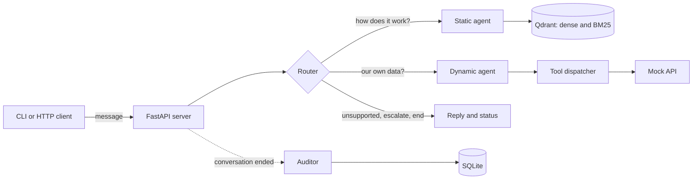

# Support Agent Sandbox

A customer support agent for an HR and payments product. It answers two kinds of questions in one conversation:

- **How does the product work?** Answered from the supplied help articles, with the sections it used as sources.
- **What is going on in my account?** Answered by calling a read-only mock API, with every tool call visible.

It handles follow-ups and corrections, keeps conversations isolated, asks when something is ambiguous or missing,
says so honestly when a tool fails, and hands off (or ends) when a request is outside what it can do. An auditor agent
reviews each finished conversation, and a human approves or rejects its suggestions.

It comes with a chat CLI, an HTTP API, a Docker setup, and an evaluation harness with a frozen test set and the traces
of every run.

- [How it works](#how-it-works)
- [Quick start](#quick-start)
- [HTTP API](#http-api)
- [CLI](#cli)
- [Configuration](#configuration)
- [Evaluation](#evaluation)
- [Trade-offs and limitations](#trade-offs-and-limitations)
- [Project layout](#project-layout)
- [How AI tools were used](#how-ai-tools-were-used)
- [Unfinished work](#unfinished-work)

## How it works



Every message goes through the **router** first. It sees the message and the conversation so far, and decides one of:

| Action | Meaning |
|---|---|
| `answer` | Send one or two self-contained queries to the agents. The router rewrites each query so it stands on its own ("sorry, I meant contractors" becomes "How many contractors do we have?"). A message that mixes a how-to and a data question goes to both agents and the answers are combined. |
| `unsupported` | The request is outside what the system can do (wallet, time off, refunds, changing data, ...). The reply says so and offers to escalate or end. The conversation stays open for the customer's choice. |
| `escalate` | The customer asks for a human, or accepts the offer. The conversation is closed with status `escalated`. |
| `end` | The customer says thanks or that they are done. The conversation is closed with status `ended`. |

### Static agent (how the product works)

1. **Ingestion at server start, idempotent.** The product guide is parsed with [Chonkie](https://github.com/chonkie-inc/chonkie)
   (markdown processor, then a recursive chunker, 300 tokens). Each chunk gets the markdown heading path as its citation,
   for example `Part 2 - Niural Pay > How to add a vendor`. Chunk ids are hashes of the model, heading and text, so a
   restart embeds only new chunks and deletes stale ones.
2. **Hybrid retrieval.** Each chunk is stored in Qdrant twice: a dense OpenAI embedding (`text-embedding-3-small`) and a
   BM25 sparse vector, both over the heading plus the text. A question fetches 12 chunks, fused with reciprocal rank fusion.
3. **Whole sections, not fragments.** The 12 chunks are collapsed to their unique parent sections (up to 6), and the full
   section text is handed to the model, so it sees the context around the matching chunk.
4. **Grounded sources.** The model answers by calling an `answer_question` tool with the answer and the numbers of the
   sections it actually used. The sources shown to the customer are only those. If the guide does not contain the answer,
   it says so and the source list is empty.

### Dynamic agent (the customer's own data)

The mock account API has six read-only endpoints. The model sees six tools:

| Tool | Endpoint | Optional filters |
|---|---|---|
| `list_employees` | `GET /employer/{id}/employees` | `status` (list), `employment_type`, `department`, `state`, `city`, `name` |
| `get_employee` | `GET /employer/{id}/employee/{employee_id}` | needs `employee_id` |
| `list_vendors` | `GET /vendors` | `name` |
| `list_vendor_invoices` | `GET /vendor-invoices` | `status` (list), `vendor_name`, `invoice_number` |
| `get_vendor_invoice` | `GET /vendor-invoices/{invoice_id}` | needs `invoice_id` |
| `get_transaction` | `GET /transactions/{transaction_id}` | needs `transaction_id` |

- **The arithmetic is done in code, not by the model.** A `ToolDispatcher` (`app/tools/tools.py`, a `match` statement
  with one case per tool) applies the filters and adds `count`, `count_by_status` and `total_by_currency` to every list
  result. "How many active employees" and "how much do we owe Orrery" are read off those fields.
- **Errors are results.** A 404, a missing argument or an unknown tool comes back to the model as an error result.
  The prompt tells it to say it does not have access, then offer to look up something else or escalate. It never
  invents data. The loop is capped at 6 tool rounds per question.
- **The clock is pinned.** The dataset is built as though today is 2026-09-28, which is what makes a bill overdue. The
  date is in the prompt and in `TODAY`.
- **Read-only.** The prompt forbids offering actions the agent cannot take (contacting people, approving, paying).

### Conversations, isolation and observable tool calls

- The server keeps each conversation's history in memory, keyed by a conversation id. Two conversations never share
  history. Ended and escalated conversations are removed from memory. Nothing is stored for the demo.
- The history the models see never reaches the client. What the client gets back for every message is the reply, the
  conversation status, and what the agent did: the route, the rewritten queries, the sources and **every tool call**
  (tool, arguments, the API call it made, and whether it worked). See [HTTP API](#http-api).
- If the LLM fails after its retries (3 attempts, with more reasoning on the retries), the reply is an apology and the
  conversation stays open.

### Auditor and human review

When a conversation ends, however it ends (the client quits, or the agent ends or escalates it), the auditor reads the
whole conversation in a background thread. It sees each question, the routing, every tool call with the start of its
result, the help sections the agent was given, the sources cited and the replies. It records a 1 to 5 score, whether
the conversation **ended on a good note**, an outcome (`resolved`, `correctly_escalated`, `unnecessary_escalation`, ...),
reasons, issues per turn and concrete suggestions, in SQLite.

Nothing is applied automatically. A person reviews the audits (`main.py audit` or `GET /audits`) and approves or
rejects the suggestions, and any change that is kept must still pass the golden set. The auditor is a reviewer, not
ground truth: it can only judge what it can see, so it can miss an omission (for example an approver it did not know was
available).

## Quick start

You need Docker with Compose, [`uv`](https://docs.astral.sh/uv/) with Python 3.12 (for the CLI, tests and evals), and an
OpenAI API key.

```bash
cp .env.example .env              # then put your key in OPENAI_API_KEY
docker compose up --build         # server on http://localhost:9090
curl localhost:9090/health        # {"status":"ok"} once the guide is ingested
uv sync
uv run python main.py             # chat
```

The first start downloads the BM25 model from Hugging Face and embeds the guide, so allow a minute for `/health` to turn
green. `docker compose` waits for Qdrant, and the app's own health check only passes once Qdrant holds the chunks.

**Slow Docker build?** The image installs Python packages from PyPI. If PyPI is slow from where you are, build against
a nearer mirror that is fully synced with PyPI:

```bash
PYPI_MIRROR=https://pypi.tuna.tsinghua.edu.cn/simple docker compose up --build
```

Two mirrors failed when I tried: one lagged behind PyPI (a pinned package was missing) and one rate-limited parallel
downloads. `uv.lock` pins every file by hash, so the same files are installed from any mirror.

**Without Docker:** leave `QDRANT_URL` empty and the server uses an in-memory Qdrant (it re-embeds the guide on each
start, which costs a fraction of a cent):

```bash
uv run uvicorn app.http.server:app --port 9090
```

**Tests:** `uv run pytest` runs 19 unit tests for the mock API and the tool dispatcher. They make no LLM calls.

## HTTP API

Base URL `http://localhost:9090`. Interactive docs are at `/docs`. A conversation is: create it, send messages, delete it.

| Method and path | Purpose |
|---|---|
| `GET /health` | `200 {"status":"ok"}` when Qdrant answers and the guide is ingested, otherwise `503`. |
| `POST /conversations` | Start a conversation. Returns `{"conversation_id": "..."}`. |
| `POST /conversations/{id}/messages` | Send `{"message": "..."}`. Returns the reply and everything the agent did. |
| `DELETE /conversations/{id}` | End the conversation (the CLI calls this on exit). `204` even if it already ended. Triggers the audit. |
| `GET /audits` | The auditor's verdicts, newest first. `?review=pending` for unreviewed ones. |
| `GET /audits/{id}` | One audit with the full conversation record. |
| `POST /audits/{id}/review` | `{"decision": "approved" or "rejected", "note": "..."}`. The human in the loop. |

```bash
ID=$(curl -s -X POST localhost:9090/conversations | python3 -c "import sys,json;print(json.load(sys.stdin)['conversation_id'])")

curl -s -X POST localhost:9090/conversations/$ID/messages \
  -H 'content-type: application/json' \
  -d '{"message": "Is Marisol Okonjo'"'"'s onboarding finished, or is something outstanding?"}'
```

A real response (the reply is shortened here):

```json
{
  "reply": "Marisol Okonjo's onboarding is not finished yet.\n\n- Current status: PENDING_ONBOARDING\n- Onboarding progress: 4 of 5 steps complete\n- Outstanding step: I-9 Section 2\n  - Status: PENDING\n  - Blocked on...",
  "status": "active",
  "route": "dynamic",
  "queries": [
    {"agent": "dynamic", "query": "Is Marisol Okonjo's onboarding finished, or is something outstanding?"}
  ],
  "sources": [
    "GET /employer/current/employees",
    "GET /employer/current/employee/emp-03100"
  ],
  "tool_calls": [
    {"tool": "list_employees", "arguments": {"name": "Marisol Okonjo"}, "endpoint": "GET /employer/current/employees", "ok": true},
    {"tool": "get_employee", "arguments": {"employee_id": "emp-03100"}, "endpoint": "GET /employer/current/employee/emp-03100", "ok": true}
  ]
}
```

| Field | Meaning |
|---|---|
| `reply` | What to show the customer. When there are sources, a `Sources:` list is appended to the text. |
| `status` | `active` (keep going), `ended` or `escalated` (the conversation was closed; further messages get `404`). |
| `route` | `static`, `dynamic`, `static+dynamic`, `unsupported`, `escalate`, `end`, or `error` (the LLM failed and the reply is an apology). |
| `queries` | The queries the router sent to each agent, as rewritten. |
| `sources` | Help-article sections (static) or API calls (dynamic) the answer is based on. Empty when nothing supports it. |
| `tool_calls` | Every tool call: `tool`, `arguments`, `endpoint` (null if the call was rejected before reaching the API), `ok`. |

Errors: `404` for an unknown or already closed conversation, `422` for an empty message. An LLM failure is a `200`
with `route: "error"` and an apology, so a client can keep going.

## CLI

```bash
uv run python main.py                        # chat (same as: main.py chat)
uv run python main.py chat --log session.jsonl
uv run python main.py audit                  # review the auditor's verdicts
uv run python main.py --url http://host:9090 chat
```

**Chat.** After every answer it prints what the agent did, so you can see the question, the route and each tool call
(abridged example):

```
you> Why hasn't Halberd Components been paid yet?
  route: dynamic
  tool call 1: list_vendor_invoices({"vendor_name": "Halberd Components"})
      -> GET /vendor-invoices  [ok]
  tool call 2: get_vendor_invoice({"invoice_id": "vinv-2041"})
      -> GET /vendor-invoices/vinv-2041  [ok]
agent> Halberd Components has one outstanding bill: INV-2041, awaiting approval from Beatrix Nolan ...

Sources:
- GET /vendor-invoices
- GET /vendor-invoices/vinv-2041
```

`/new` starts a new conversation, `/quit` (or Ctrl-C) exits and ends the conversation, and `--log` appends every turn
(question, reply, route, tool calls) to a JSONL file. When the agent escalates or ends a conversation the CLI says so and
starts a fresh one.

**Audit mode** is the human in the loop: `list` (pending), `all`, `show <id>` (transcript, tool calls and the
verdict), `approve <id> [note]`, `reject <id> [note]`, `quit`. Audits appear a few seconds after a conversation ends.

## Configuration

Settings come from environment variables or `.env` (`app/config.py`, see `.env.example`).

| Variable | Default | What it does |
|---|---|---|
| `OPENAI_API_KEY` | (required) | |
| `LLM_MODEL` | `gpt-5-nano` | Static and dynamic agents. |
| `LLM_REASONING_FIRST` / `LLM_REASONING_RETRY` | `low` / `medium` | Reasoning effort on the first attempt and on retries. |
| `ROUTER_MODEL` | `gpt-5-mini` | The router (`minimal` reasoning, `low` on retry). |
| `AUDITOR_MODEL` | `gpt-5-mini` | The auditor (`low` reasoning, `medium` on retry). |
| `EMBED_MODEL` | `text-embedding-3-small` | 1536 dimensions. |
| `CHUNKS_TO_FETCH` / `SECTIONS_TO_RETURN` | `12` / `6` | Retrieval width. |
| `MAX_TOOL_ROUNDS` | `6` | Tool-call rounds per question for the dynamic agent. |
| `LLM_RETRIES` | `3` | Attempts per LLM call. |
| `TODAY` | `2026-09-28` | The dataset's "today". |
| `QDRANT_URL` | empty | Empty means an in-memory Qdrant. Compose sets `http://qdrant:6333`. |
| `DB_PATH` | `audit.db` | SQLite file for audits. Compose sets `/data/audit.db`. |

**Why these models.** The two agents run on the cheapest model because it matched the mid-size one on the golden set
(see below) at a third of the cost and with lower latency. The router and auditor run on `gpt-5-mini` because their
decisions matter most and are cheap in tokens: at `low` reasoning the small model classified the same wallet question as
`unsupported` only 3 times in 6, and `gpt-5-mini` did it 5 times in 5, at about 1.7s a call.

## Evaluation

### The golden set

`evals/golden_set.json` is a frozen set of 57 cases. Facts come from `docs/PRODUCT_GUIDE.md` and the mock data
(today is 2026-09-28). Cases are not edited to make a run pass; new behaviour gets new cases.

| Category | Cases | What it checks |
|---|---|---|
| `docs`, `docs_gap` | 12 | Answers from the guide, with the right source sections. One case is a question the guide only partly covers. |
| `out_of_scope` | 3 | Honest "I can't find that" instead of an invented answer, with no sources. |
| `account` | 11 | The eight example questions from the dataset (count by status, filter by state, onboarding, why not in payroll, why unpaid, overdue, sum owed, failed payment) and a few more. |
| `ambiguity` | 3 | Missing or ambiguous information (no transaction id, "her" with no context, headcount that depends on status). |
| `multi_turn` | 5 | Corrections ("I meant contractors"), pronouns ("and Tobias?"), a follow-up on the docs, a vendor correction. |
| `isolation` | 1 | A second conversation must not know what the first one discussed. |
| `tool_failure` | 4 | Injected API errors (500, 404 on a list, 500 on a detail call) and a real 404. The agent must say it has no access, offer to escalate, and invent nothing. |
| `routing` | 18 | Run through the whole path (router, then agents). Scored on the route taken, the conversation status and the rewritten query. Covers the four router actions, mixed questions, rewrites and a tool failure. |

The first 39 cases call one agent directly. The 18 routing cases go through `ChatService`.

### Scoring

Each turn is scored by code. There is no LLM judge, so scoring is deterministic and free:

- required text (alternatives, regular expressions and named phrase lists), forbidden text;
- sources (`sources_any`, `no_sources`);
- tools that must be called, and a cap on tool calls;
- for routed cases: the route, the status, and words the rewritten query must contain.

A case passes only if every turn passes. With repeats, a case that passes some repeats and fails others is reported as
**flaky**. Each run also records latency, LLM calls, tokens and an estimated cost (price-tracker list prices, not billed
amounts, so treat cost as a relative figure).

```bash
uv run python -m evals.run --label <name>                    # everything; traces go to evals/runs/<name>/
uv run python -m evals.run --label <name> --only id1,id2      # a few cases
uv run python -m evals.run --label <name> --category routing --repeats 3
uv run python -m evals.rescore --from <name> --to <name>-rescored   # score saved traces again, no LLM calls
uv run python -m evals.compare <before> <after>               # fixed, regressed, still failing, per case
```

A full run costs a few cents and takes about 5 minutes. Each run folder has `summary.json` (pass rates by category,
flaky cases, latency, tokens, cost) and `traces.jsonl`, one line per turn: the question, the route and rewritten
queries, every tool call with the start of its result, the sources, the answer, the failed checks, latency and token use.

### The improvement loop: one failure, one targeted change

**Initial result** (`baseline`, code at commit `39815f3`): 26 of 39 cases. Reading all 13 failing answers showed 8 were my
scorer's fault, not the agent's: the model writes curly apostrophes ("couldn’t") and my expected phrases had straight
ones, and two phrase lists missed equivalent wording. I fixed the scorer, **recorded both numbers**, and re-scored the
same traces (`baseline-rescored`, no new LLM calls): **34 of 39**. The five real failures were Priya, headcount, a
retrieval miss, a missing mention of the Needs approval tab, and a terse answer.

**Failure inspected with its trace: `acct-priya-payroll`.** The question was "Why isn't Priya showing up in this
payroll run?". The trace shows a single `list_employees` call, and the answer says "I couldn't find an ONBOARDED employee
named Priya". The agent assumed that anyone in a payroll run must be `ONBOARDED`, filtered on that, found nobody and
stopped. Priya is `DISMISSED`, and that is the answer.

**Targeted change:** one rule in `app/agents/prompts/dynamic.md` (commit `432e7ed`): do not add a status filter when
looking up a named person, because the status is often the answer; for "why is X missing from payroll", find them with no
filter and call `get_employee`. The diff is `git show 432e7ed -- app/agents/prompts/dynamic.md`. The initial code is
`git checkout 39815f3`. The evals call the agents directly, so the router added in the same commit does not affect them.

**Before and after, same 39 cases, same scorer** (`baseline-rescored` against `revised-priya`):

| | Before | After |
|---|---|---|
| `acct-priya-payroll` | fail | **fixed** |
| account category | 10/11 | 11/11 |
| Total | 34/39 | 33/39 |

**The two regressions, explained.** The total went down by one because two other cases failed. Neither is a behaviour
change from the prompt edit:

- `acct-failed-payment-no-id`: the agent still asked for the missing details, but wrote `transaction_id` with an
  underscore, and my phrase list did not match it. A check problem.
- `multi-vendor-correction`: after a correction to Kestrel Freight the agent called `get_vendor_invoice` and reported
  that Beatrix Nolan approved that bill, which is true. My check forbade her name to catch a carry-over from the previous
  vendor, but the same person approves several bills. A badly designed check.

The next run (`revised-no-offers`, a different prompt change that does not touch those paths) passed both again, and
`docs-onboarding-tab` changed its wording between two runs although the docs path was untouched. So single runs are noisy.

**Decision: keep the change.** It fixes the target, nothing else got worse for a real reason, and the cost and latency did
not move (about $0.011, median 3.5s). I would not have trusted that on one run, so everything after this is repeated.

### Everything that was run

| Run | Result | Notes |
|---|---|---|
| `baseline` | 26/39 (67%) | First run. 77 LLM calls, about $0.010, median 4.1s, p95 6.6s. |
| `baseline-rescored` | 34/39 (87%) | Same traces, scorer fixed (curly quotes, two phrase lists). |
| `revised-priya` | 33/39 | The targeted change above. |
| `revised-no-offers` | 34/39 | New rule: never offer actions the agent cannot take (it had offered to "contact the approver"). A 12-sample check found 0 offers. |
| `halberd-repeat` | 4/6 | `acct-halberd-unpaid` x6. In 2 runs the agent answered from the bill list and never called `get_vendor_invoice`, so the approver was not named. |
| `routing-baseline` | 53/54 runs, 17/18 cases stable | 18 routing cases x3. The one failure was an over-strict check (the answer was right). About $0.034. |
| `retr-current-5-3` | 26/33 runs | The 11 docs cases x3 with 5 chunks and 3 sections. `docs-onboarding-tab` failed 3 of 3: the `The employee list` section ranked 6th to 9th. |
| `retr-wide-12-6` | 29/33 runs | Same cases with 12 chunks and 6 sections. Adopted. |
| `dyn-fixes` | 20/20 runs | After telling the model the list tools are summaries, and adding `count_by_status`: Halberd, headcount, Priya and Marisol x5. Halberd went from 4/6 to 5/5. |
| `final-nano` | 52/57 (91%) | All 57 cases on the final code, agents on `gpt-5-nano`. About $0.025, median 3.8s, p95 7.9s. |
| `final-nano-rescored` | **55/57 (96%)** | Four checks fixed (below). |
| `final-mini` | 51/57 (90%) | Same, agents on `gpt-5-mini`. About $0.079, median 4.5s, p95 9.1s. |
| `final-mini-rescored` | 52/57 (91%) | |

By category for `final-nano-rescored`: account 11/11, routing 18/18, tool_failure 4/4, out_of_scope 3/3, multi_turn 5/5,
isolation 1/1, docs_gap 1/1, docs 10/11, ambiguity 2/3.

**Model choice.** Moving the agents from `gpt-5-nano` to `gpt-5-mini` did not improve accuracy (96% against 91%
rescored), was slower and cost about three times as much, so the agents stay on `gpt-5-nano`. The failures also differed
between the two, which suggests a single run of 57 is too small to rank models finely.

**Retrieval.** Fetching 12 chunks and returning up to 6 sections raised the docs cases from 26 to 29 of 33 runs and fixed
the section the ranking was missing. The cost is a longer prompt on every docs question (up to 6 sections instead of 3).

**The final scorer pass.** Four more checks were changed after I saw the results, and I am listing them because I do
not want the numbers to look better than they are: `transaction_id` added as an accepted phrase; the Beatrix exclusion
replaced with `Halberd`/`INV-2041`; the requirement to call `get_employee` dropped for `route-payroll-why-is-data`
(answering "dismissed" straight from the list result is correct); and "error accessing" / "seeing an error" added to the
"no access" phrases. Earlier runs keep the scoring they had at the time.

**Still failing in `final-nano-rescored`** (both are real):

- `docs-pending-onboarding`: the answer says it could not find a definition of "Pending onboarding" and never says the
  person is not payable. The guide describes the Onboarding tab, not that exact status name.
- `acct-failed-payment-no-id`: asked why a payment failed without a transaction id, the agent asks for the invoice id,
  but a failed payment can only be explained from the transaction, and no endpoint maps an invoice to one.

### What these results do not show

- 57 cases is small, and most cases were run once. Where I repeated cases the results moved by a case or two between
  runs, so differences of one or two cases are noise.
- The checks are string checks. They cannot tell a good answer from a lucky phrase, and I changed some after seeing
  results (listed above). There is no LLM judge and no human grading of answer quality.
- The test questions are mine. They follow the dataset's example questions, but an unseen question can still fail.
- The cost figures use list prices from third-party trackers, not billed amounts.

## Trade-offs and limitations

- **Cheap models, mixed answers.** The agents run on the smallest model. It is fast and cheap but not always complete (a
  one-line answer to "how do I add an employee" appeared in some runs), and its choices vary between runs (the Halberd
  detail call was skipped about one run in three before the tool descriptions changed).
- **Maths in code, not in the model.** Counts, filters and totals are computed by the dispatcher. That removes a whole
  class of errors but means a question the dispatcher does not support (a new filter) needs a code change, not a prompt.
- **Whole sections as context.** Better grounding than isolated chunks, at the price of a longer prompt.
- **Conversations are in memory only.** A restart loses them, there is no timeout for abandoned conversations, and the
  server is a single process. That is fine for a demo and not for production.
- **No authentication or rate limiting.** The mock API accepts any token, serves one employer and ignores `employer_id`.
- **The auditor runs in a daemon thread.** An audit in flight when the server stops is lost.
- **First start needs network.** It downloads the BM25 model from Hugging Face, and the Docker build needs PyPI (see the
  mirror note). The Qdrant server must match the `qdrant-client` version (both 1.20): the client leaves BM25 vectors for
  the server to compute, and an older server fails with "InferenceService is not initialized".
- **No supplied "evaluation interface".** The package did not include one, so the HTTP API above is the interface.

## Project layout

```
main.py                      CLI: chat and audit modes
app/
  config.py                  settings (environment variables, .env)
  agents/
    agents.py                RouterAgent, StaticAgent, DynamicAgent, AuditorAgent
    prompts/                 router.md, static.md, dynamic.md, auditor.md
    tools/                   route_message, answer_question, submit_audit, and api_tools.yaml (the six API tools)
  rag/                       ingestor.py (chunk, hash, embed, upsert), retriever.py (hybrid search, sections)
  http/                      server.py (startup and wiring), routes.py, services.py (a chat turn), models.py
  tools/                     llm.py (OpenAI wrapper, retries, reasoning), embed.py, tools.py (dispatcher),
                             convo_manager.py (history, isolation, what the client sees), logger.py
  repository/                vector.py (Qdrant), db.py (SQLite audits)
  mock_api/                  the supplied mock API, its data and its documentation
docs/PRODUCT_GUIDE.md        the supplied help articles
evals/                       golden_set.json, run.py, rescore.py, compare.py, faults.py, runs/ (summaries and traces)
tests/                       unit tests for the mock API and the dispatcher
Dockerfile, docker-compose.yml, .env.example
```

## How AI tools were used

This project was built with Claude Code, an AI coding assistant, working under my direction. I chose the architecture
(a router in front of two agents, hybrid retrieval returning whole sections, the dispatcher computing counts and totals,
the `unsupported` router action, the auditor with a human in the loop) and decided what to keep or roll back. The
assistant wrote most of the code and ran the experiments.

How the output was checked, rather than trusted:

- unit tests for the mock API and the dispatcher, written against facts computed from the data (16 active employees, 6 in
  New York state, 3,480 USD owed to one vendor);
- the golden set and its traces, read case by case, including the cases where the assistant's first explanation was wrong
  (several failures turned out to be my scorer, not the agent, and I recorded that);
- small repeated experiments before changing anything that affects behaviour (router models, retrieval width, the
  read-only rule, the detail-call fix), instead of judging from one run;
- running the CLI and the HTTP API by hand against the real server and container, including the failure paths.

## Unfinished work

- Tests for the router, `ChatService` and the audit store. Only the mock API and the dispatcher have unit tests; the
  router and the service are covered by the routing evals.
- Escalating automatically after the last LLM retry fails. Today the reply is an apology and the conversation stays open.
- The two weak answers listed under Evaluation, and a terse "how do I add an employee" answer that appeared in some runs.
- Turning low-scoring audited conversations into draft golden cases for review. The auditor and the review step exist;
  this last link of the loop does not.
